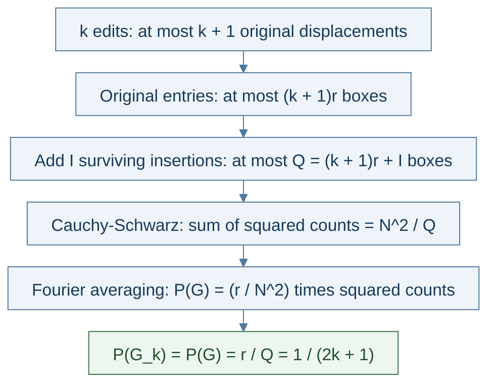

# General-k total-mass proof map

A **box** is a pair (u, b): output symbol u and input residue b modulo r. The diagram proves a
bound on the **sum over all ideal outcomes**, not on each outcome separately.



Render from the repository root:

```sh
mmdc -i report_figures/general_k_proof.md -o report_figures/general_k_proof.svg
```

Mermaid CLI extracts the diagram and writes `general_k_proof-1.svg`, which
Section 4.1 of `glitchy_period_finding_report.typ` includes directly.
